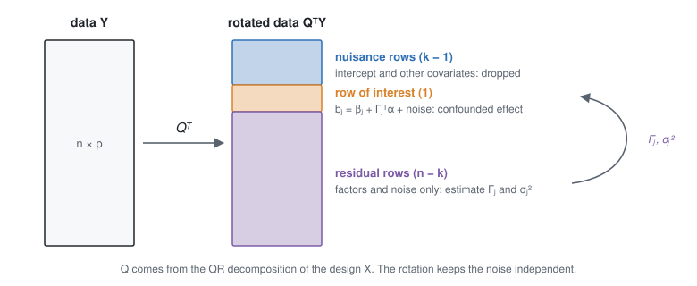

# 3. Separating confounders from effects

This page works on a Gaussian scale. ``Y`` is an ``n \times p`` matrix of log-abundances; in the PLN fit it is the
matrix of variational means ([§5](pln.md)). For gene ``j``, following [§2](model.md):

```math
Y_{\cdot j} = X B_j + W \Gamma_j + E_{\cdot j},
\qquad E_{\cdot j} \sim \mathcal N(0, \sigma_j^2 I_n),
\qquad X^\top W = 0,
```

where ``W`` is the ``n \times (q + 1)`` matrix of factors, offset factor first, and ``B_{kj} = \beta_j + \Gamma_j^\top
\alpha``.

## 3.1 The rotation

The covariate of interest is the last column of ``X``. Write the QR decomposition ``X = QR``: ``Q`` is an ``n \times
n`` orthogonal matrix and ``R`` is upper triangular. Rotate the data: ``\tilde Y = Q^\top Y``. The noise of the
rotated data is still ``\mathcal N(0, \sigma_j^2 I_n)``, because ``Q`` is orthogonal. The rows of ``\tilde Y`` form
three blocks (Wang et al. 2017):



- **Nuisance rows** (the first ``k - 1``) carry the intercept and the other covariates. They are dropped.
- **The row of interest** (row ``k``) carries the confounded effect. Dividing it by ``R_{kk}`` gives the raw estimate
  of each gene:

```math
b_j = \tilde Y_{kj} / R_{kk} \;\sim\; \mathcal N\big(\beta_j + \Gamma_j^\top \alpha,\; s_j^2\big),
\qquad s_j = \sigma_j / \lvert R_{kk} \rvert .
```

- **Residual rows** (the last ``n - k``) contain the factors and the noise, but no trace of the design.

**Result** — the residual rows see the confounders but not the effects. A factor analysis on these rows estimates
the loadings ``\Gamma_j`` and the variances ``\sigma_j^2``. It cannot absorb the effects of interest, which is the
main risk of factor-based corrections.

!!! details "Derivation"
    ``Q^\top X = R`` is zero below row ``k``, and ``Q^\top W`` is zero in the first ``k`` rows because ``X^\top W =
    0``. So the residual rows of ``Q^\top Y_{\cdot j}`` are ``Q_{\text{res}}^\top W \Gamma_j +
    Q_{\text{res}}^\top E_{\cdot j}``. Row ``k`` is ``R_{kk} B_{kj} + u^\top E_{\cdot j}``, with ``u`` the column
    ``k`` of ``Q``. The other coefficients do not appear because ``R`` is upper triangular. In real data the factors
    are not exactly orthogonal to ``X``. The realised part ``u^\top W`` then adds a term common to all genes, which
    is absorbed in ``\alpha``. The ``\alpha`` estimated below is this data-specific value. It is the value that
    removes the confounding in this data set.

## 3.2 Factor analysis on the residual rows

The residual block, of size ``(n - k) \times p``, is fitted by a factor model with one variance per gene. The fit
alternates two steps, as in the alternation of Owen & Wang (2016):

1. With the variances fixed, the best rank-``q`` fit is a singular value decomposition of the residual block, with
   each gene weighted by ``1/\sigma_j``. The offset factor is fitted first: its loadings are fixed to one, so it is a
   weighted mean of each row.
2. With the fit fixed, ``\sigma_j^2`` is the residual sum of squares divided by the ``d = n - k - q - 1`` degrees of
   freedom.

## 3.3 The number of factors

Too few factors leave confounding. Too many fit the noise and use up degrees of freedom, which matters with few
samples. [`choose_q`](@ref) chooses ``q`` by **count splitting** (Neufeld et al. 2024):

1. Split every count in two parts: a training part and a test part.
2. For each candidate ``q``, fit the PLN model on the training part.
3. Score each fit by the likelihood of the test part, and keep the best ``q``.

**The split must give independent parts.** The simple split keeps each read with probability ``\theta``:
``y^{(1)} \sim \text{Binomial}(y, \theta)``. The two parts are then independent given the latent ``Z_{ij}``. But they
share ``Z_{ij}``, and so its noise ``\varepsilon_{ij}``. When this noise dominates the Poisson noise, which is the
case for counts above a few tens, a fit that has learned the noise also predicts the test part. Too many factors are
chosen.

`choose_q` therefore splits by **beta-binomial thinning** (Neufeld, Dharamshi, Gao & Witten 2024):

```math
y^{(1)} \mid y \sim \text{BetaBinomial}\big(y;\; \theta r_j,\; (1 - \theta) r_j\big),
\qquad r_j = \frac{1}{e^{\sigma_j^2} - 1} .
```

**Result** — with this ``r_j``, the two parts are uncorrelated for a Poisson-lognormal count, whatever its mean. If
``\sigma_j^2`` is overestimated, the parts are negatively correlated, which can only favour fewer factors.

!!! details "Derivation"
    For a count that is Poisson given a rate of mean ``m`` and variance ``v``, the beta-binomial split gives
    ``\operatorname{Cov}(y^{(1)}, y^{(2)}) = \theta(1 - \theta)\,(v r - m^2)/(r + 1)``. This is zero at ``r = m^2 /
    v``, the inverse squared coefficient of variation of the rate. For a lognormal rate, ``v / m^2 = e^{\sigma_j^2}
    - 1``. The binomial split is the limit ``r \to \infty``. With ``r`` too small, ``v r - m^2 < 0``.

The ``\sigma_j^2`` needed for the split come from a fit with the current choice of ``q``. The procedure starts at
``q = 0``, whose ``\sigma_j^2`` include the variance of the factors (too large: the safe side). It repeats until the
choice is stable.

With very few samples, a fit with factors can diverge on the training part. This happens when a gene has zero
training counts in some samples: a loading can push these samples towards ``-\infty``. Such a ``q`` gets the score
``-\infty``, and the choice moves towards ``q = 0``, which has no loadings.

With the default fit ([§5.1](pln.md)), ``q`` is an upper bound: the factors that the data do not support are
switched off and removed during the fit. Several values of ``q`` then give the same fit, and `choose_q` may return a
larger ``q`` than the number of factors kept.

The keyword `ε` of `choose_q` is ``\theta``. Results are in [§7.5](validation.md).

## 3.4 Estimating the confounders

Each raw estimate follows a regression on the known loadings with unknown coefficients ``\alpha``:
``b_j = \beta_j + \Gamma_j^\top \alpha + \text{noise}``. Two assumptions identify ``\alpha``:

- **Negative controls** (RUV-4, Gagnon-Bartsch et al. 2013). For ``j \in C``, ``\beta_j = 0``, so a weighted
  regression of the ``b_j`` of the controls on their ``\Gamma_j`` estimates ``\alpha``. This needs at least ``q + 1``
  controls.
- **Sparsity** (CATE of Wang et al. 2017; MOUTHWASH of Gerard & Stephens 2020). Most ``\beta_j`` are zero, so
  ``\alpha`` is the value that concentrates the corrected estimates ``b_j - \Gamma_j^\top \alpha`` at zero.
  MOUTHWASH does this with a likelihood ([§4.3](empirical_bayes.md)).

**Result** — the compositional shift is estimated like any other confounder. It is the coefficient ``\alpha_0`` of
the offset factor, whose loadings are all one.

- With controls, ``\hat\alpha_0`` is the weighted mean raw estimate of the controls, after removing the other
  factors. It measures the change of the other genes relative to the controls.
- Without controls, ``\hat\alpha_0`` puts the mode of the effects at zero, as in LinDA (Zhou et al. 2022), but
  jointly with the other confounders. It does not measure a global change.

## 3.5 Why the offset factor has fixed loadings

A free factor could learn loadings close to one. But the loadings are estimated on the residual rows, and the
compositional shift associated with the condition lives in the row of interest. In the residual rows this shift may
be weak or absent, and a free factor would not find it. With the loadings fixed to one, nothing has to be learned. A
comparison is in [§7.2](validation.md).

## Functions

- [`factor_analysis`](@ref): factor analysis with the optional offset factor.
- [`choose_q`](@ref): the number of factors by count splitting.
- [`mouthwash`](@ref): rotation, factor analysis and the estimation of [§4](empirical_bayes.md), on Gaussian data.
