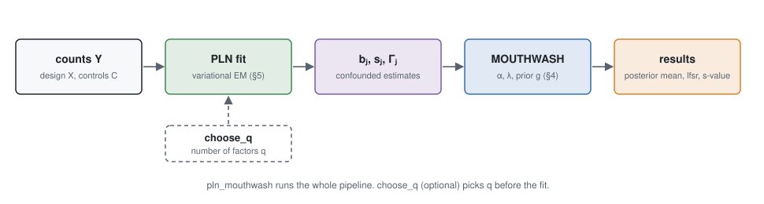

# PLNRUV.jl

*Differential expression from RNA-seq counts, adjusted for hidden confounders and for the compositional nature of
sequencing.*

An RNA-seq experiment compares the expression of thousands of genes between conditions. Two problems bias this
comparison.

- **Hidden confounders.** Variation that is not in the design changes many genes at once. If it differs between the
  conditions, it creates false differences or hides true ones.
- **Composition.** Sequencing measures the *share* of each gene among the reads, not its amount per cell. If the total
  amount of RNA per cell changes between conditions, this change is invisible in the shares.

PLNRUV.jl treats both problems with one model. The counts follow a Poisson-lognormal (PLN) distribution. The hidden
confounders are latent factors, as in CATE (Wang et al. 2017) and MOUTHWASH (Gerard & Stephens 2020). The
compositional offset is one more latent factor, with a known effect: it shifts every gene of a sample by the same
amount.

Neither problem can be solved from the reads alone. The package needs one of two extra assumptions:

- a set of **negative control genes** that do not change; or
- **sparsity**: most genes do not change.

Every result about a global change of transcription depends on which assumption is used and on whether it holds
([§1.3](problem.md#1.3-Fold-changes-are-only-relative), [§8](limits.md)).



## Contents

1. [**The problem**](problem.md). What a count measures, why fold changes are only relative, and what hidden
   confounders are.
2. [**The model**](model.md). Poisson counts on a latent Gaussian layer, with the offset factor.
3. [**Separating confounders from effects**](confounders.md). The rotation of the data, the factor analysis and the
   number of factors.
4. [**Empirical Bayes**](empirical_bayes.md). The prior on the effects, the joint estimation of the confounders, and
   the shrinkage of the variances.
5. [**Fitting the PLN layer**](pln.md). The variational EM algorithm.
6. [**Simulation by binomial thinning**](simulation.md). Realistic data with known effects.
7. [**Validation**](validation.md). All the numerical results.
8. [**Assumptions and limits**](limits.md). What can break the method, and how to interpret a global change.

The [notation page](notation.md) lists every symbol. Each symbol has one meaning in the whole manual.

## How to read this manual

The text is written for biologists who know some probability. Each idea is stated in words, then as an equation.
Two labels mark the logical status of a statement:

- **Assumption**: a choice about the biology or the measurement. It could be wrong.
- **Result**: a mathematical consequence of the assumptions.

Derivations are in folded boxes. You can skip them:

!!! details "Derivation"
    The step-by-step argument behind a result. The main text never depends on it.

The method pages contain no benchmark numbers. All numbers are on the [validation page](validation.md).

## Quick start

```julia
using PLNRUV

# counts: integer matrix, samples x genes
# X: design matrix with an intercept first and the covariate of interest last
# controls: indices of negative control genes (optional)
q = choose_q(counts, X).q                               # number of hidden factors
fit = pln_mouthwash(counts, X, q; controls = controls)  # q factors + the offset factor
res = fit.mouthwash
res.mean      # posterior mean of each log fold change (natural log; divide by log(2) for log2)
res.lfsr      # local false sign rate: probability that the reported sign is wrong
res.svalue    # report the genes with svalue < 0.05
res.α[1]      # the compositional shift α₀, relative to the controls
res.converged # false if the fit stopped at maxiter

# without controls, sparsity identifies the confounders; α₀ is then only defined relative to the bulk of genes
fit_sparse = pln_mouthwash(counts, X, q)
```
