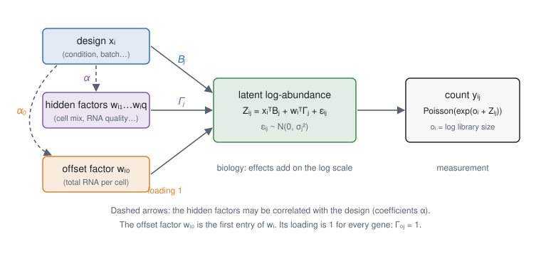

# 2. The model

## 2.1 Counts on a latent Gaussian layer

The model has two layers. The top layer is the biology: the latent log-abundance ``Z_{ij}`` of each gene in each
sample. On this log scale, effects add up. The bottom layer is the measurement: the counts.



- **Assumption** — given the latent log-abundance, the counts are independent Poisson variables:

```math
y_{ij} \mid Z_{ij} \sim \text{Poisson}\big(e^{\,o_i + Z_{ij}}\big),
```

  where ``o_i = \log N_i`` is the log library size.

- **Assumption** — the latent log-abundance is a regression on the design and on latent factors, plus Gaussian noise:

```math
Z_{ij} = x_i^\top B_j + w_i^\top \Gamma_j + \varepsilon_{ij},
\qquad \varepsilon_{ij} \sim \mathcal N(0, \sigma_j^2).
```

The terms are:

- ``x_i^\top B_j``: the design (intercept, covariates, condition) and the coefficients of gene ``j``;
- ``w_i^\top \Gamma_j``: the factors of sample ``i`` times their loadings on gene ``j`` ([§1.4](problem.md));
- ``\varepsilon_{ij}``: the biological variability of gene ``j`` between samples, with variance ``\sigma_j^2``.

This is the Poisson-lognormal (PLN) model of Aitchison & Ho (1989), with the low-rank structure of Chiquet et al.
(2018). With ``\mu_{ij} = x_i^\top B_j + w_i^\top \Gamma_j``, a count has mean and variance

```math
\mathbb E[y_{ij}] = \bar y_{ij} = e^{o_i + \mu_{ij} + \sigma_j^2/2},
\qquad
\operatorname{Var}[y_{ij}] = \bar y_{ij} + \bar y_{ij}^2\,\big(e^{\sigma_j^2} - 1\big).
```

The first term is the Poisson noise of sampling reads. It dominates for small counts. The second term is the
biological variability. It dominates for large counts. Zeros need no special treatment and no pseudo-count.

!!! details "Why Poisson-lognormal and not negative binomial"
    Both have the same mean–variance relationship. The lognormal layer has two advantages here. First, effects,
    factors and noise all add up on the log scale. The latent layer is then an ordinary Gaussian factor model, and
    the methods for hidden confounders (CATE, RUV, MOUTHWASH) apply to it. Second, the model is closed under binomial
    thinning: keeping each read with probability ``\rho`` turns a Poisson(``m``) count into a Poisson(``\rho m``)
    count. The simulations of [§6](simulation.md), which thin real counts, therefore stay inside the model.

## 2.2 The offset factor

- **Assumption** (on by default) — the first factor has the same loading for every gene: ``\Gamma_{0j} = 1``.

This is the offset factor of [§1.5](problem.md). Its value ``w_{i0}`` is a shift of sample ``i``, common to all its
genes. It corrects the library size ``o_i`` for the unknown total RNA content of the sample.

## 2.3 What the parameters mean

In the fit, the factors are uncorrelated with the design (``X^\top W = 0``, see [§3](confounders.md)). The part of the
hidden factors that is associated with the condition is therefore inside the coefficient of the condition:

```math
B_{kj} = \beta_j + \Gamma_j^\top \alpha .
```

Here ``k`` is the column of the condition in ``X``. ``\beta_j`` is the true effect of the condition on gene ``j``. The
vector ``\alpha`` holds the associations of the factors with the condition. Its first entry ``\alpha_0`` is the
compositional shift: the change of the total RNA content, as measured against the reference that identifies it.

**Result** — the data identify ``B_{kj}``, not ``\beta_j`` and ``\alpha`` separately ([§1.3](problem.md),
[§1.4](problem.md)). One more assumption is needed:

- **Assumption** — either a set ``C`` of control genes has ``\beta_j = 0``, or most ``\beta_j`` are zero
  (sparsity).

The two options use the same code. A control gene is a gene whose prior is the point mass at zero
([§4.3](empirical_bayes.md)).

## 2.4 How the model is fitted

The fit has two stages:

1. A variational EM fits the PLN layer ([§5](pln.md)). It returns, for each gene, a raw estimate ``b_j`` of
   ``B_{kj}``, its standard error ``s_j``, and the loadings ``\Gamma_j``.
2. MOUTHWASH estimates ``\alpha``, a prior on the effects and the variance inflation together. It then shrinks each
   effect ([§4](empirical_bayes.md)).

This is an empirical Bayes method: the prior is estimated from the data, so there is no prior to choose. The
loadings ``\Gamma`` and the associations ``\alpha`` are point estimates. The uncertainty of ``\alpha`` is added to the
standard errors.

A fully Bayesian version is kept on the `fully-bayesian` branch of the repository. It is a Gibbs sampler that
integrates over ``\alpha`` and ``\Gamma``. It is not part of the package until we understand why it is miscalibrated
on real data.

## Functions

- [`pln`](@ref): fit the PLN layer.
- [`pln_mouthwash`](@ref): the two stages together.
