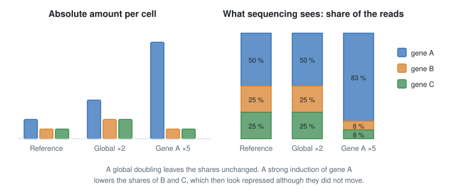
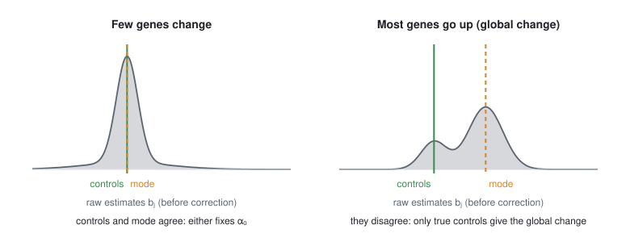

# 1. The problem

## 1.1 What a count measures

An RNA-seq library is a sample of the RNA molecules of a tissue. Each read is assigned to a gene. The data are a table
of counts ``y_{ij}``: the number of reads of gene ``j`` in sample ``i``, for ``n`` samples and ``p`` genes.

Let ``a_{ij}`` be the absolute abundance of gene ``j`` in sample ``i``, for example in molecules per cell. The
sequencer reads ``N_i`` molecules from library ``i``. These reads are shared among the genes in proportion to their
abundance:

```math
\mathbb{E}[y_{ij}] = N_i \, \frac{a_{ij}}{\sum_{l} a_{il}} .
```

On the log scale, the abundance of the gene and the properties of the sample separate:

```math
\log \mathbb{E}[y_{ij}] = \log N_i - \log \textstyle\sum_l a_{il} + \log a_{ij} .
```

The library size ``N_i`` is known. The total RNA content ``\sum_l a_{il}`` is not. So each sample has an unknown
shift, the same for all its genes.



The figure shows the two consequences. A global change of the RNA content leaves the shares unchanged: it is
invisible. A strong change of a few abundant genes changes the shares of all the others: they look changed although
they are not.

!!! details "Poisson or multinomial counts?"
    One can view the counts of a sample as a multinomial draw of ``N_i`` reads, or as independent Poisson counts.
    **Result** — both views give the same inference on the ``a_{ij}``, as long as each sample has its own free
    offset (the multinomial–Poisson transform, Baker 1994). Let ``y_{ij} \sim \text{Poisson}(e^{o_i +
    \eta_{ij}})``. Given the total ``N_i = \sum_j y_{ij}``, the counts are multinomial with probabilities
    ``e^{\eta_{ij}} / \sum_l e^{\eta_{il}}``, which do not depend on ``o_i``. The likelihood factorises into a
    Poisson term for ``N_i`` and this multinomial term. Maximising over a free ``o_i`` fits ``N_i`` exactly and
    leaves the multinomial term unchanged. So the counts are compositional through their mean, not through their
    distribution. The package uses the Poisson view.

## 1.2 When the total RNA content changes

Most normalisation methods assume that the total RNA per cell is the same in all conditions. This includes scaling by
library size, TMM and the median-of-ratios of DESeq2 (Evans et al. 2018). When the total changes, these methods
shift every fold change by the same unknown amount. They miss the global change and can reverse the sign of many
effects (Lovén et al. 2012; Coate & Doyle 2015).

A few studies measured this bias:

- **c-Myc** amplifies the genes already expressed. Normalised data hide this amplification (Lovén et al. 2012).
- **Endoreduplication** in tomato fruits raises the transcript content per nucleus, which changes the conclusions of
  the analysis (Pirrello et al. 2018).
- **Time of day** changes the RNA content of plant cells. A normalisation that accounts for it changes the list of
  differentially expressed genes (Laosuntisuk et al. 2024).
- **Light.** When dark-grown seedlings are exposed to light, the cotyledons roughly double their transcript levels.
  Standard analyses of the same samples did not detect this increase (Schivre et al. 2025).

Spike-in molecules added in a fixed amount per cell can measure such changes (van de Peppel et al. 2003; Taruttis
et al. 2017). They are rarely available.

## 1.3 Fold changes are only relative

Let ``x_i = 1`` for treated samples and ``0`` for controls. Suppose the treatment multiplies the abundance of gene
``j`` by ``e^{\beta_j}``. Then

```math
\log \mathbb{E}[y_{ij}] = o_i + c_j + x_i \beta_j ,
```

where ``o_i`` is the unknown sample shift of §1.1 and ``c_j`` the baseline level of gene ``j``.

Add a constant ``\alpha_0`` to every ``\beta_j``, and subtract ``x_i \alpha_0`` from every ``o_i``. The expected
counts do not change.

**Result** — from the reads alone, the fold changes are known only up to a common shift ``\alpha_0``. The values
``\beta_j`` and ``\beta_j + \alpha_0`` fit the data equally well.

Every normalisation method chooses ``\alpha_0``, usually by assuming that most genes do not change. Two kinds of
information can fix it:

- **Negative controls.** A set ``C`` of genes known not to change: ``\beta_j = 0`` for ``j \in C``. Examples are
  spike-ins or stable reference genes.
- **Sparsity.** Most genes do not change, so the distribution of the ``\beta_j`` has its mode at zero.

The two assumptions answer different questions.

- With **controls**, ``\alpha_0`` is the change of the bulk of genes *relative to the controls*. It is an absolute
  change only if the controls are constant per cell. Spike-ins added per microgram of RNA, for example, are constant
  per amount of RNA, not per cell. They cannot reveal a change of the RNA content per cell.
- With **sparsity**, ``\alpha_0`` is set so that the most common change is zero. The fold changes are then relative
  to the bulk of genes. A global change cannot be measured this way: if most genes go up, sparsity calls their
  common change zero.



## 1.4 Hidden confounders

The second problem has the same structure. Expression data contain variation that is not in the design but changes
many genes together. Methods that remove it model it as a few hidden factors (Stegle et al. 2012; Gagnon-Bartsch et
al. 2013; Wang et al. 2017; Gerard & Stephens 2020). Each factor ``l`` is described by:

- a **factor** ``w_{il}``: its value in sample ``i``;
- **loadings** ``\Gamma_{lj}``: how strongly gene ``j`` responds to it.

The contribution to the log-abundance is the product ``w_{il}\Gamma_{lj}``.

**When they bias the results.** A factor that is independent of the condition only adds noise. A factor that differs
between the conditions creates false effects. This happens in two ways:

- **By design.** The factor and the condition are associated by chance or by the way the samples were collected.
- **By biology.** The treatment changes the factor itself.

The second case needs care. A factor caused by the treatment is part of the treatment's effect. Removing it answers a
narrower question: what changes *besides* this factor? Whether this is the right question depends on the study.

**The confounded effect.** Write the association of the factors with the condition as ``\alpha``: the treated
samples have on average ``\alpha_l`` more of factor ``l``. The apparent effect of the treatment on gene ``j`` is then

```math
\beta_j + \Gamma_j^\top \alpha ,
```

the true effect plus the effect carried by the factors. **Result** — ``\beta_j`` is not identified: any ``\alpha``
can be traded against the effects. The same two kinds of information resolve it. The controls have ``\beta_j = 0``,
so their apparent effects ``\Gamma_j^\top \alpha`` reveal ``\alpha``. With sparsity, ``\alpha`` is the value that
makes most corrected effects zero.

## 1.5 One problem, not two

Compare §1.3 and §1.4. The compositional shift adds ``\alpha_0`` to every gene of the treated samples. It is a hidden
factor whose loading is the same for every gene: ``\Gamma_{0j} = 1``.

**The compositional offset is a confounder with a known loading.** Only its association with the condition,
``\alpha_0``, has to be estimated. The package adds this *offset factor* to the hidden factors. Controls or sparsity
then estimate the compositional shift and the confounders together, with the same machinery.

The loading 1 is an assumption: the change of the RNA content multiplies all genes by the same factor. A change that
favours some genes, such as the amplification of already active genes by c-Myc, is split in two. Its common part goes
to ``\alpha_0``, and the rest appears as gene-specific effects.
