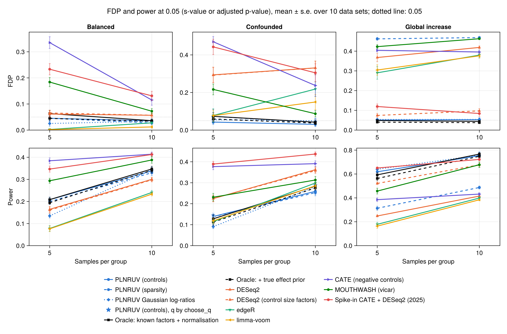
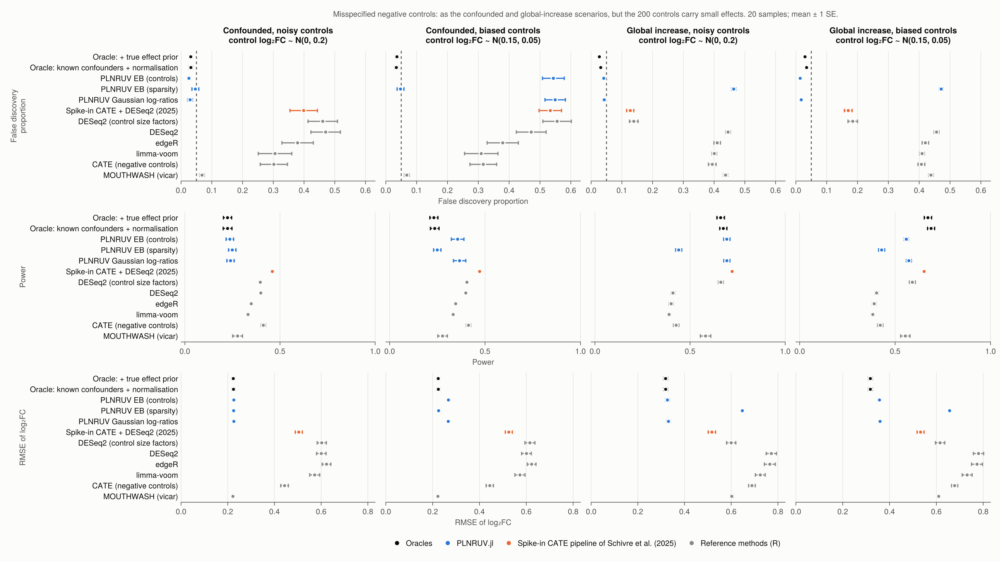

# 7. Validation

This page collects all the numerical results. Each component is checked against a known truth and, where one exists,
against the reference implementation in R. The R packages are used only in the separate `benchmark/` environment.

**FDP** is the false discovery proportion among the genes reported at s-value < 0.05 (or BH-adjusted p-value < 0.05
for the methods without s-values). Null genes and wrong signs both count as errors. **Power** is the proportion of
non-null genes reported with the right sign.

## 7.1 The simulator

- **Thinning probabilities.** `thin_counts` and `seqgendiff::thin_diff`, with the same design and coefficients on
  counts of ``10^7``: the largest difference in thinning probability over 6 000 counts is ``6.9 \times 10^{-4}``,
  the binomial noise expected at that depth.
- **Confounded groups.** By default `thin_2group` keeps a group assignment only if its correlations are within 0.15
  of the target, so the target is met in every data set ([§6.3](simulation.md)). The score alone
  (`assignment = :threshold`, as in seqgendiff) meets it only on average. Both given seqgendiff's own surrogate
  variables, with target correlations ``(0.6, 0.2)``, mean realised correlation over 30 replicates of 100 GTEx samples:

| | factor 1 (target 0.6) | factor 2 (target 0.2) |
|---|---|---|
| PLNRUV, `assignment = :threshold` | 0.58 | 0.19 |
| seqgendiff | 0.46 | 0.15 |

## 7.2 ash and MOUTHWASH

- **ash**, 5 000 effects, 20 % non-null with sd 2, standard errors 0.5: ``\hat\pi_0 = 0.78`` (truth 0.8 plus the
  near-zero effects), RMSE 0.29 against 0.50 for the raw estimates, FDP 4.8 %.
- **MOUTHWASH against vicar.** With the same model (three free factors, normal likelihood, no offset factor), the two
  implementations agree to two or three decimals in RMSE, number of discoveries and FDP.
- **The offset factor.** Simulated log abundances, 40 samples, 1 000 genes, two confounders, compositional shift of 1
  correlated with the group, three replicates:

| | RMSE | FDP |
|---|---|---|
| PLNRUV MOUTHWASH (offset factor, 2 free factors) | 0.10–0.12 | 3–7 % |
| vicar, 3 free factors | 0.15–0.26 | 6–15 % |
| vicar, 2 free factors (shift not modelled) | 0.63–1.04 | 71–81 % |

The offset coefficient is estimated at ``\hat\alpha_0 \approx 1.0``, the true shift, with or without control genes.

## 7.3 The PLN layer

- **The latent values.** The Lambert W solution matches a brute-force maximisation (``M = 0.50043`` against
  ``0.50045`` on a grid of step ``5\times 10^{-5}``). ``\mathcal W_0(e^t)`` is accurate to ``3\times10^{-15}`` and
  finite up to ``t = 800``.
- **Degrees of freedom of the variances** ([§5.4](pln.md)). Variances drawn with ``a_0 = 2``, 4 samples, 2 000 genes:

| | estimated ``a_0`` |
|---|---|
| exact EM (Gaussian data) | 2.02 |
| mean field, every count counted (Gaussian data) | 5.84 |
| PLN fit, GTEx-like counts | 2.25 (common prior), 2.34 (trend) |

  Without the correction, ``a_0`` ran to its upper bound on low counts and the fit did not converge.
- **The variance trend.** On 200 GTEx muscle samples (4 000 genes), ``\sigma_j^2`` follows a U-shape in expression:
  0.78 for the weakest genes, about 0.09 in the upper middle, 0.33 for the strongest. A local fit predicts the
  variances best (cross-validated error 0.59 against 1.03 for one common value and 0.68 for the DESeq2 form), with a
  flat optimum for spans 0.05–0.2. Around the trend the genes still spread like ``a_0 \approx 2``.
- **Uncertainty of the loadings** ([§4.3](empirical_bayes.md)). Estimates confounded with ``\alpha = 2``, loadings
  known up to an error of variance 0.02: without the term, FDP 43 % and ``\hat\lambda = 3.1``; with it, FDP 3 % and
  ``\hat\lambda = 1.03``. On GTEx (confounded, 5 per group), the null residuals of the highest-expressed genes had
  1.8 times the modelled variance; with the term, 1.2.
- **Weak factors.** With 5 factors and 10 samples per group, the fit took 901 iterations without the
  parameter-expanded step and 57 with it, and reached a slightly higher ELBO.
- **Stopping rules.** A 100 times tighter tolerance changes s-values by at most 0.001 and no discovery.

## 7.4 Benchmark on thinned GTEx data

Two-group experiments are built from GTEx v8 skeletal muscle by binomial thinning ([§6](simulation.md)): 2 000
genes, 200 negative controls, 5 or 10 samples per group, 10 data sets per scenario. Every method gets the same
number of hidden factors, ``q = 2``.

- **Balanced**: 20 % of the genes change, log₂ fold changes ``\sim \mathcal N(0, 0.8)``; the groups are uncorrelated
  with the two main factors (|ρ| ≤ 0.15).
- **Confounded**: the same effects; the groups are correlated with the two main factors (0.6 and 0.2, ± 0.15).
- **Global increase**: 60 % of the genes go up, log₂ fold changes ``\sim \mathcal N(1, 0.5)``, confounded as above.

The oracle knows the two factors and the true normalisation.

FDP / power, means over 10 data sets:

| scenario | per group | PLNRUV (controls) | PLNRUV (sparsity) | oracle | DESeq2 | edgeR | limma-voom | vicar | spike-in CATE |
|---|---|---|---|---|---|---|---|---|---|
| balanced | 5 | 4.5 % / 0.21 | 4.5 % / 0.20 | 6.3 % / 0.21 | 6.1 % / 0.16 | 0.2 % / 0.08 | 0.2 % / 0.08 | 18 % / 0.29 | 23 % / 0.35 |
| balanced | 10 | 3.6 % / 0.34 | 2.7 % / 0.33 | 3.6 % / 0.35 | 5.7 % / 0.30 | 2.8 % / 0.24 | 1.2 % / 0.23 | 7.2 % / 0.39 | 13 % / 0.41 |
| confounded | 5 | 4.2 % / 0.14 | 7.3 % / 0.14 | 7.3 % / 0.13 | 29 % / 0.22 | 7.8 % / 0.11 | 7.7 % / 0.12 | 22 % / 0.23 | 44 % / 0.39 |
| confounded | 10 | 3.0 % / 0.26 | 3.9 % / 0.25 | 4.2 % / 0.28 | 33 % / 0.36 | 22 % / 0.30 | 15 % / 0.29 | 8.7 % / 0.31 | 31 % / 0.44 |
| global increase | 5 | 5.1 % / 0.62 | 46 % / 0.31 | 4.9 % / 0.59 | 37 % / 0.25 | 29 % / 0.18 | 30 % / 0.16 | 42 % / 0.46 | 12 % / 0.65 |
| global increase | 10 | 5.3 % / 0.75 | 47 % / 0.49 | 4.4 % / 0.77 | 42 % / 0.42 | 38 % / 0.40 | 38 % / 0.38 | 46 % / 0.68 | 8.4 % / 0.72 |

What this shows:

- PLNRUV with controls stays close to 5 % in all three scenarios, with the power of the oracle.
- Without controls, PLNRUV is calibrated when most genes do not change, and fails, as expected, when most go up
  ([§1.3](problem.md)).
- The standard pipelines lose control as soon as the groups are confounded. The higher power of CATE and of the
  spike-in pipeline comes with a high FDP.
- The Gaussian log-ratio branch ([§5.7](pln.md)) is calibrated at these sizes, with less power at 5 per group.

**Misspecified controls.** The confounded and global scenarios again, 10 samples per group, but the 200 controls
carry small effects: *noisy* controls, ``\mathcal N(0, 0.2)`` each, or *biased* controls, which shift together,
``\mathcal N(0.15, 0.05)``.

- **Noisy controls** average out: PLNRUV with controls stays at 2.1 % (confounded) and 3.8 % (global).
- **Biased controls** break every control-based method in the confounded scenario: PLNRUV 60 %, DESeq2 with control
  size factors 42 %, the spike-in pipeline 42 %. The sparsity branch is not affected (2.5 %). In the global scenario
  PLNRUV with controls stays calibrated (1.2 %), with less power (0.58 against 0.74).

Controls that move with the condition, even slightly, are the main threat to a control-based analysis
([§8](limits.md)).

**Smaller designs** (2 or 3 samples per group) are not reported yet. With so few samples a target confounding can
only be reached on selected sets of samples ([§6.3](simulation.md)), and these results need another design.

## 7.5 The PLN fit and the number of factors

**Variance prior and likelihood.** The same data sets (balanced, confounded, global; 5 data sets each), PLNRUV with
controls, FDP / power:

| scenario | per group | trend prior, ``t`` (default) | common prior | trend prior, normal likelihood | earlier fit |
|---|---|---|---|---|---|
| balanced | 5 | 4.8 % / 0.22 | 4.0 % / 0.18 | 11 % / 0.30 | 2.4 % / 0.12 |
| balanced | 10 | 3.0 % / 0.35 | 2.5 % / 0.35 | 5.4 % / 0.39 | 2.6 % / 0.34 |
| confounded | 5 | 2.3 % / 0.15 | 0.0 % / 0.11 | 10 % / 0.22 | 4.1 % / 0.10 |
| confounded | 10 | 4.9 % / 0.28 | 3.6 % / 0.28 | 5.9 % / 0.30 | 5.0 % / 0.29 |
| global increase | 5 | 4.7 % / 0.64 | 4.5 % / 0.63 | 5.5 % / 0.66 | 5.1 % / 0.65 |
| global increase | 10 | 5.3 % / 0.77 | 5.2 % / 0.77 | 5.6 % / 0.78 | 5.1 % / 0.77 |

- The trend prior gains power over the common prior, and stays calibrated.
- The normal likelihood is anti-conservative with 5 samples per group: the ``t`` is needed there. With 10 per group
  the ``t`` is slightly conservative.
- The earlier fit (fixed scores and loadings, removed from the package) is calibrated here, with less power at 5
  per group.

**Choosing ``q``** ([§3.3](confounders.md)). PLN simulations, 20 samples, 400 genes: `choose_q` returns the true
number of factors for 0, 1, 2 and 3 factors, in one pass. On GTEx it chooses 1–4 factors at 5 per group and 3–5 at
10 per group. With this ``q`` instead of ``q = 2``, PLNRUV with controls has an FDP of 6.9 % (5 per group) and 4.5 %
(10 per group) in the confounded scenario, for the same power.

**Automatic relevance determination does not replace `choose_q`.** Given the largest possible bound on GTEx
(confounded, 5 data sets), the fit kept 3–4 of 6 factors at 5 per group and 8–9 of 16 at 10 per group. The FDP rose
from 4.9 % with ``q = 2`` to 7.0 % at 10 per group.
