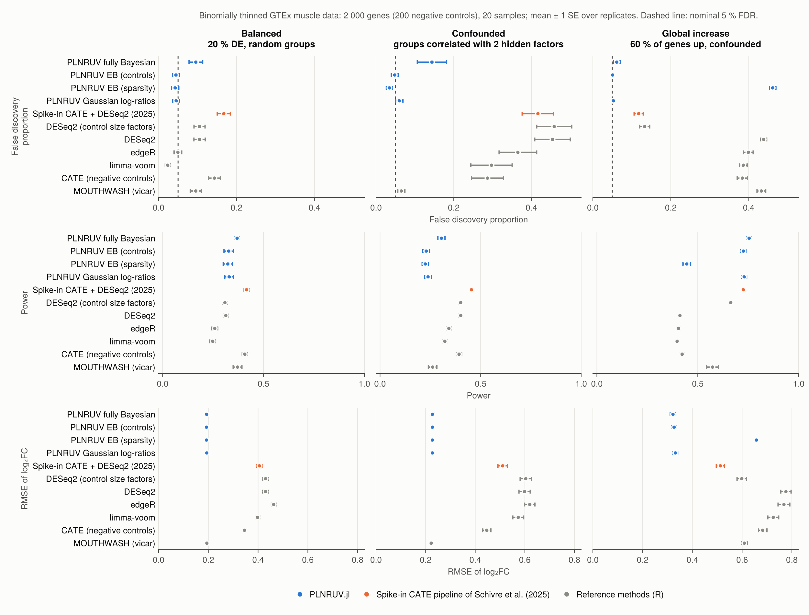

# 7. Validation

Each component is checked against a known truth, and, where one exists, against the reference implementation in R.
The R packages are used only for these checks, in the separate `benchmark/` environment. The package itself is pure
Julia. Unless stated otherwise, "FDP" is the false discovery proportion among the genes declared at s-value < 0.05,
counting both null genes and wrong signs as errors.

Sections 7.1–7.3 check each component on simulations; section 7.4 benchmarks the whole method against standard
pipelines on real counts.

## 7.1 The simulator

- **Thinning probabilities.** `thin_counts` and `seqgendiff::thin_diff`, with the same design and coefficients on
  counts of ``10^7``: the largest difference in thinning probability over 6 000 cells is ``6.9 \times 10^{-4}``,
  the binomial noise expected at that depth.
- **Confounded groups.** Both simulators given seqgendiff's own surrogate variables, with target correlations
  ``(0.6, 0.2)``, 30 replicates of 100 GTEx samples:

| | factor 1 (target 0.6) | factor 2 (target 0.2) |
|---|---|---|
| PLNRUV | 0.58 | 0.19 |
| seqgendiff | 0.46 | 0.15 |

## 7.2 ash and MOUTHWASH

- **ash**, 5 000 effects, 20 % non-null with sd 2, standard errors 0.5: ``\hat\pi_0 = 0.78`` (truth 0.8 plus the
  near-zero effects), RMSE 0.29 against 0.50 for the raw estimates, FDP 4.8 %.
- **MOUTHWASH against vicar.** With the same model (three free factors, normal likelihood, no offset factor), the two
  implementations agree to two or three decimals in RMSE, number of discoveries and FDP.
- **The offset factor.** Simulated log abundances, 40 samples, 1 000 genes, two confounders, compositional shift of 1
  correlated with the group, three replicates:

| | RMSE | FDP |
|---|---|---|
| PLNRUV MOUTHWASH (offset factor, 2 free factors) | 0.10–0.12 | 3–7 % |
| vicar, 3 free factors | 0.15–0.26 | 6–15 % |
| vicar, 2 free factors (shift not modelled) | 0.63–1.04 | 71–81 % |

The offset coefficient is estimated at ``\hat\alpha_1 \approx 1.0``, the true shift, with or without control genes.

## 7.3 The PLN layer

Counts simulated from the PLN model: 30 samples, 1 500 genes, 150 controls, two confounders, compositional shift of
1, overdispersions ``\sigma_j^2 \sim \text{Gamma}(4, 0.05)``.

- **E-step.** The Lambert W solution matches a brute-force maximisation (``M = 0.50043`` against ``0.50045`` on a grid
  of step ``5\times 10^{-5}``). ``W_0(e^t)`` is accurate to ``3\times10^{-15}`` and finite up to ``t = 800``.
- **Standard errors.** With no confounding, at low depth (22 % zeros): ``\hat\lambda \approx 1.0``, coverage of 95 %
  intervals 95–96 %, FDP 2.5–4.6 %. The latent-scale standard error of [§5.4](pln.md) needs no inflation.
- **Against a Gaussian analysis of log-CPM.** Similar at a median count of 32. At a median count of about 3, the PLN
  branch has a lower RMSE (0.33–0.43 against 0.36–0.45) and a lower FDP.
- **Variance shrinkage**, low depth with confounding, mean FDP over four replicates: none 7.1 %, limma 6.3 %,
  **vash 5.4 %**, at equal RMSE. On variances with a bimodal distribution, the mean squared error of
  ``\log\tilde s_j^2`` is 0.42 raw, 0.27 with limma and 0.24 with vash.

**Remaining miscalibration of the empirical Bayes branch.** With confounding and low counts, the FDP is still slightly
above the nominal level. It comes from the estimation of the confounders (the Gaussian pipeline shows the same
excess), not from the PLN layer.

## 7.4 Benchmark on thinned GTEx data

Two-group experiments are simulated from GTEx v8 skeletal muscle by binomial thinning ([§6](simulation.md)): 2 000
genes, 200 negative controls, 20 samples, 10 replicates per scenario. *Balanced*: 20 % of the genes change, log₂ fold
changes ``\sim \mathcal N(0, 0.8)``, random groups. *Confounded*: the same effects, groups correlated with two hidden
factors of the samples (0.6 and 0.2). *Global increase*: 60 % of the genes go up, log₂ fold changes ``\sim \mathcal
N(1, 0.5)``, confounded. Two oracles give a reference: PLN with the confounding factors and the true normalisation
known, and the same with the true effect distribution in place of the fitted ash prior.

| scenario | PLNRUV EB (controls) | PLNRUV EB (sparsity) | oracle | DESeq2 | edgeR | limma-voom | vicar | spike-in CATE + DESeq2 |
|---|---|---|---|---|---|---|---|---|
| balanced | 4.5 % / 0.33 | 4.3 % / 0.32 | 5.0 % / 0.33 | 10.5 % / 0.31 | 5.0 % / 0.26 | 2.3 % / 0.25 | 9.6 % / 0.37 | 16.7 % / 0.42 |
| confounded | 4.8 % / 0.23 | 3.4 % / 0.22 | 4.4 % / 0.22 | 45.4 % / 0.40 | 36.5 % / 0.34 | 29.7 % / 0.32 | 6.6 % / 0.26 | 41.7 % / 0.45 |
| global increase | 5.1 % / 0.73 | 46.2 % / 0.45 | 4.5 % / 0.72 | 43.8 % / 0.41 | 39.9 % / 0.40 | 38.6 % / 0.40 | 43.3 % / 0.57 | 11.8 % / 0.73 |

FDP / power at level 0.05 (s-values for PLNRUV and vicar, BH-adjusted p-values otherwise), means over 10 replicates.
PLNRUV with controls is calibrated in all three scenarios and has the power of the oracles: with 20 samples,
estimating the confounders, the offset and the prior costs almost nothing. Without controls (sparsity), it is
calibrated when most genes do not change, and fails, as it must, when most genes go up
([§1.4](problem.md)). The standard pipelines are calibrated only without confounding; the higher power of CATE and of
the spike-in pipeline comes with an FDP of 12–42 %.

**Misspecified controls.** The same confounded and global scenarios, but the 200 controls carry small effects:
*noisy* controls, log₂ fold change ``\sim \mathcal N(0, 0.2)`` each, or *biased* controls, which shift together,
``\sim \mathcal N(0.15, 0.05)``, as a spike-in whose amount follows the condition.

Noisy controls are averaged out: PLNRUV with controls stays calibrated (2.6 % confounded, 4.1 % global). Biased
controls are a different matter. In the confounded scenario every control-based method fails, PLNRUV included (FDP
54 %; DESeq2 with control size factors 56 %, the spike-in pipeline 53 %), because a shared shift of the controls moves
the estimate of the offset, and with it every gene; the sparsity branch is not affected (4.8 %). In the global
scenario PLNRUV with controls stays calibrated (1.4 %), with less power (0.56 against 0.69). Controls that move with
the condition, even slightly, are the main threat to a control-based analysis ([§8](limits.md)).

With few samples the picture changes: with 2–3 samples per group, the inference has only 1–2 residual degrees of
freedom per gene and every method, the oracles included, has an excess of false discoveries ([§8](limits.md)).

